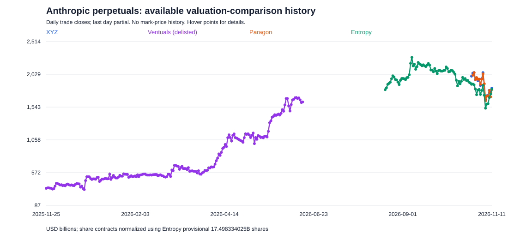
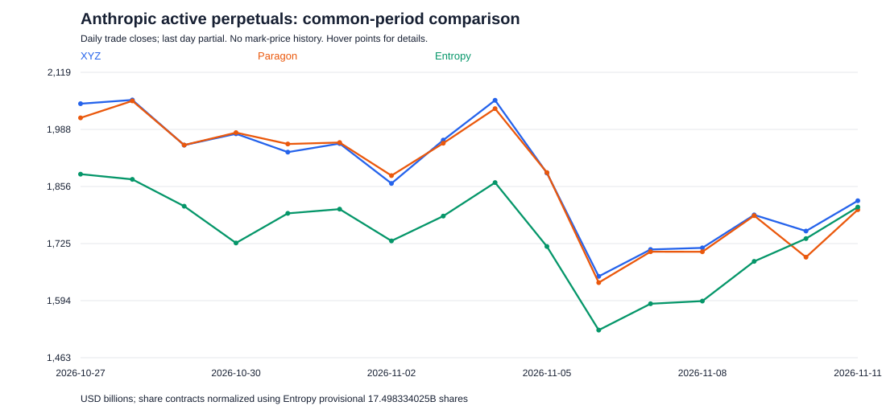

# Anthropic perpetuals on Hyperliquid: price history and implied valuation

**Snapshot retrieval started:** 2026-11-11T04:42:11.320700+00:00. All dates are UTC unless stated otherwise.

## Bottom line

The current Hyperliquid native market and all 10 HIP-3 builder registries contain **four identifiable Anthropic contracts: three active, one delisted**. On **Entropy's published provisional 17.498334025-billion-share comparison basis**, the active markets imply approximately **$1.81–$1.82 trillion**. This is not a verified final issuer market capitalization.

The crucial unit distinction: **XYZ and Paragon quote USD per anticipated share; Entropy and Ventuals quote valuation in USD billions. A $104 share-price quote does not mean a $104B company.**

## Current snapshot

| Market | Status | API mark | Comparable valuation* | 24h mark change | 24h volume | Open interest |
|---|---|---:|---:|---:|---:|---:|
| `xyz:ANT` | Active | $104.25 | $1.8242T | +6.12% | $109.213M | $104.072M |
| `vntl:ANTHROPIC` | **Delisted** | $1,619.30 | $1.6193T | +0.00% | $0.000M | $0.000M |
| `para:ANTH` | Active | $103.70 | $1.8146T | +2.86% | $0.018M | $0.081M |
| `io:ANTH` | Active | $1,809.20 | $1.8092T | +9.66% | $143.921M | $192.167M |

**Comparable valuation:** uses each valuation contract's native USD-billion scale, or a share-price contract multiplied by Entropy's published provisional share-count scalar. Ventuals is an archived API value, **not a current tradable valuation**. Its published final settlement was **$1,618.90**, equivalent to **$1.61890T**, on June 15, 2026. The API still shows a stale mark of $1,619.30 and oracle of $1,618.90; do not confuse the stale mark/last trade with the official settlement.

Open interest above is notional, computed as API `openInterest × markPx`; it is not margin deposited. Volume is reported 24-hour notional volume. Returns are current mark versus `prevDayPx`, not daily-candle returns. Snapshot requests are sequential/concurrent API observations, not an atomic cross-venue snapshot.

### How each price maps to valuation

| Contract | Contract's quoted unit | Valuation calculation |
|---|---|---|
| `xyz:ANT` | USD per anticipated Class A share | `mark × share count`; $104.25 × 17.498334025B = **$1.824201T** on Entropy's estimate |
| `para:ANTH` | USD per anticipated share | `mark × share count`; $103.70 × 17.498334025B = **$1.814577T** on the same basis |
| `io:ANTH` | USD billions of fully diluted valuation | $1,809.20 × $1B = **$1.809200T** directly |
| `vntl:ANTHROPIC` | USD billions of valuation | Official final settlement $1,618.90 × $1B = **$1.618900T**, historical only |

Paragon's current docs display the instrument as **ANT**, but Hyperliquid's actual API symbol is **`para:ANTH`**. The descriptions and parameters identify it as the Anthropic anticipated-share-price market.

Entropy's $1,809.20 is equivalent to approximately **$103.3927 per share** using its provisional scalar. XYZ is **0.83%** above Entropy on that basis; Paragon is **0.30%** above. These are mark comparisons, not executable arbitrage spreads. In particular, Paragon has very little volume and its latest trade is older than the snapshot; its current mark, midpoint and last trade differ.

## Price history

These are **traded OHLC candles**, not historical marks or oracle prices. The latest daily candle is partial. First observed candle means the earliest candle returned by Hyperliquid, not a separately verified listing timestamp.

| Market | Available daily candles (UTC) | Candles | First trade open | Last trade close | Trade low–high | First open → last close |
|---|---|---:|---:|---:|---:|---:|
| `xyz:ANT` | 2026-10-26 → 2026-11-11 | 17 | $138.00 | $104.22 | $90.37–$138.41 | -24.48% |
| `vntl:ANTHROPIC` | 2025-11-25 → 2026-06-15 | 203 | $327.12 | $1,619.30 | $257.47–$1,750.00 | +395.02% |
| `para:ANTH` | 2026-10-27 → 2026-11-11 | 16 | $112.00 | $103.04 | $90.61–$120.41 | -8.00% |
| `io:ANTH` | 2026-08-19 → 2026-11-11 | 85 | $1,796.80 | $1,809.10 | $1,506.70–$2,359.30 | +0.68% |

Ventuals started trading November 25, 2025 and last traded June 15, 2026; its close-to-close history ends there. It must not be carried forward as an active November quote. The 203 returned daily candles are non-empty candles, not a complete calendar-day grid.

XYZ's first observed trade was $138, versus a documented launch reference of $125. Paragon's first observed trade was $112, versus a documented launch reference of $110. The return column uses actual first observed candle opens, **not launch references**. These returns exclude funding and fees.

### All available daily valuation-comparison history

### Active markets over their shared history

These charts apply **today's Entropy estimate retrospectively** to XYZ/Paragon share prices. They are constant-share-count contract comparisons, not a reconstruction of Anthropic's actual historical cap table. Entropy/Ventuals retain their native valuation scales. The gap between the end of Ventuals and start of Entropy is deliberately not filled. Daily closes are sparse trades where a market is illiquid.

Raw-price charts: [XYZ](xyz_ANT_price_history.svg), [Paragon](para_ANTH_price_history.svg), [Entropy](io_ANTH_price_history.svg), [Ventuals](vntl_ANTHROPIC_price_history.svg).

## Share-count caveat: there is no single unqualified market cap

1. **Contract normalization basis:** Entropy's current asset directory explicitly publishes **17,498,334,025 shares**, or **17.498334025** as the estimated transition multiplier. It says this may change pending the final 424(b) prospectus. This report uses that exact number to compare contracts, not an invented round-number multiplier.
2. **Basic post-offering basis:** The November 10 S-1/A's “The Offering” section gives **7,427,991,791 Class A** plus **5,658,680,800 Class N** economic shares, totaling **13,086,672,591** without the underwriters' option. The single Class T and Class F control shares have no economic rights and are excluded. At XYZ's $104.25 this produces **$1.3643T**, rather than $1.8242T. This is a legal post-offering economic-share basis; it is not the same as an accounting-consolidated or fully diluted basis, particularly because of Public Benefit Fund treatment.
3. **Unresolved documentation discrepancy:** I could **not independently reconcile Entropy's 17.498334025B estimate to the retrieved November 10 S-1/A**. The filing's later capitalization bridge lists 7,430,143,944 Class A, 7,804,580,273 Class N, 1,704,567,865 option shares after treasury-stock adjustment, and 1,073,701,297 RSU shares. Adding these gives **18,012,993,379**, not Entropy's estimate. This bridge includes additional adjustments (including rollover notes and donation/public-benefit items) and is not automatically the contract's final scalar. Applied mechanically to XYZ's mark, it would give **$1.8779T**. Do **not** silently treat either provisional scalar as a settled final fully diluted issuer count.
4. **Final IPO terms can change:** Entropy says its final scalar is set at the IPO using the final 424(b), or the most recent S-1/A before the first official opening trade if no 424(b) is available. It then remains fixed; future issuances/buybacks can make its quoted valuation diverge from actual market cap.

Thus **$1.81–$1.82T is the answer on Entropy's currently published contract-comparison basis**, while an actual issuer market-cap answer must specify basic versus diluted shares, Public Benefit Fund treatment, and the final IPO terms. None of these perps gives ownership of Anthropic shares.

## Talos report: what “Class A-only denominator” means

I reviewed Talos's November 10 report, [Countdown to ANT](https://www.talos.com/insights/countdown-to-ant-what-the-pre-ipo-perps-markets-say-about-anthropics-ipo). It explicitly describes XYZ's post-conversion per-share denominator as Class A only, contrasting that with common-share and fully diluted conversions on other venues. This is a claim about contract reference/conversion units; the report does not provide a numerical XYZ reference-share-count field establishing a company-wide market-cap denominator.

XYZ's own linked specification says one contract references one Class A share. Thus its price is directly comparable to the listed Class A share price. It does not follow that company-wide equity value should exclude Class N. The S-1/A says Class A and Class N rights are identical except for voting and conversion.

At the snapshot's $104.25, multiplying by the filing's 7,427,991,791 post-offering Class A shares gives **$774.4B of Class A capitalization**. Multiplying by basic Class A plus Class N gives **$1.3643T**. Applying Entropy's provisional diluted estimate gives **$1.8242T**. These are different capitalization bases, not three different XYZ share prices. The $1.8242T number in this report is an explicitly selected comparison basis, **not an independently verified XYZ-published market cap**.

There is also an important qualification to Talos's discussion of Entropy's conversion: Entropy's current primary documentation says the contract **remains in market-cap units after IPO**, with `contract price = listed share price × fixed fully diluted share count / 1B`. A share-equivalent price may be computed by dividing out that scalar, but the traded quote does not itself rebase to a single-share quote. Therefore the report's general language about markets converting to per-share valuation should not be read as a literal Entropy quote rebase.

## IPO context

Anthropic's November 10 roadshow announcement gives an expected **$70–$78/share** offering range. XYZ's $104.25 mark is **33.7% above the top** of that range and **40.9% above the $74 midpoint**. An anticipated post-listing trading price need not equal an offering allocation price. XYZ's spec anticipates November 20, 2026, but explicitly warns the date can change.

## Data, scope and reproducibility

- Enumerated `perpDexs`, then `metaAndAssetCtxs` for native perps and every returned HIP-3 builder: native, xyz, flx, vntl, hyna, km, abcd, cash, para, mkts, io. Searched names for ANTH/CLAUDE and exact ticker ANT. Includes the delisted Ventuals listing. Does not prove a never-returned or permanently removed historical instrument never existed, or capture unidentified aliases; excludes spot/prediction markets and other exchanges.
- Requested `candleSnapshot` with `startTime=0` through the retrieval time at both **1d and 1h** intervals. Every series returned fewer than Hyperliquid's 5,000-candle cap, so no cap truncation is evident. Missing/no-trade periods are not forward-filled. No ticks or historical marks were downloaded.
- Raw API responses and CSVs are under [data/](data/). Daily and hourly files are named `<dex>_<symbol>_1d.csv` and `_1h.csv`.
- [Market summary](data/market_summary.csv): snapshot, liquidity and historical statistics.
- [Normalized daily history](data/daily_normalized.csv): raw daily OHLC plus normalized USD-billion OHLC and the explicit conversion multiplier.
- [Market snapshot](data/snapshot.json), [all metadata](data/all_metadata.json), and [perpetual DEX registry](data/perp_dexes.json) preserve discovery evidence.
- Source text snapshots are in [research/](research/).
- Reproduce this downloaded snapshot's tables/charts: `python analyze_anthropic.py`. `python fetch_anthropic.py` fetches new raw prices, but the narrative examples and contract constants in this analysis are snapshot-specific and must be reviewed/updated before generating a fresh report. Published contract mechanics, share-count estimates and filing updates do not automatically refresh from websites.

## Primary sources

1. [Hyperliquid public info API](https://api.hyperliquid.xyz/info) — POST queries `perpDexs`, `metaAndAssetCtxs`, `candleSnapshot`; [API documentation](https://hyperliquid.gitbook.io/hyperliquid-docs/for-developers/api/info-endpoint).
2. [XYZ pre-IPO specification index](https://docs.trade.xyz/perpetuals/specifications-and-schedules/pre-ipo-specification-index) and [pre-IPO mechanics](https://docs.trade.xyz/perpetuals/markets/pre-ipo-perpetuals).
3. [Paragon specifications](https://docs.paragon.trade/resources/specifications) and [pre-listing pricing](https://docs.paragon.trade/markets/equities/pre-listing-pricing).
4. [Entropy asset specifications — exact estimated share scalar](https://docs.entropy.io/asset-directory/pre-ipo-assets) and [valuation units, final share-count and transition rules](https://docs.entropy.io/market-types/pre-ipo-perpetuals).
5. [Ventuals valuation units](https://docs.ventuals.com/perp-specifications/private-companies) and [sunset/official Anthropic settlement](https://docs.ventuals.com/sunset-guide).
6. [Anthropic November 10 roadshow announcement](https://www.anthropic.com/news/roadshow-launch).
7. [Anthropic November 10, 2026 S-1/A, accession 0001628280-26-072484](https://www.sec.gov/Archives/edgar/data/2130357/000162828026072484/anthropicpbc-sx1ax2.htm), “The Offering,” pp. 20–25, and [SEC submissions index](https://data.sec.gov/submissions/CIK0002130357.json).
8. [Talos, Countdown to ANT, November 10, 2026](https://www.talos.com/insights/countdown-to-ant-what-the-pre-ipo-perps-markets-say-about-anthropics-ipo), especially “XYZ - The Baseline for ANT valuation” and “Entropy’s Persistent Popularity.”
