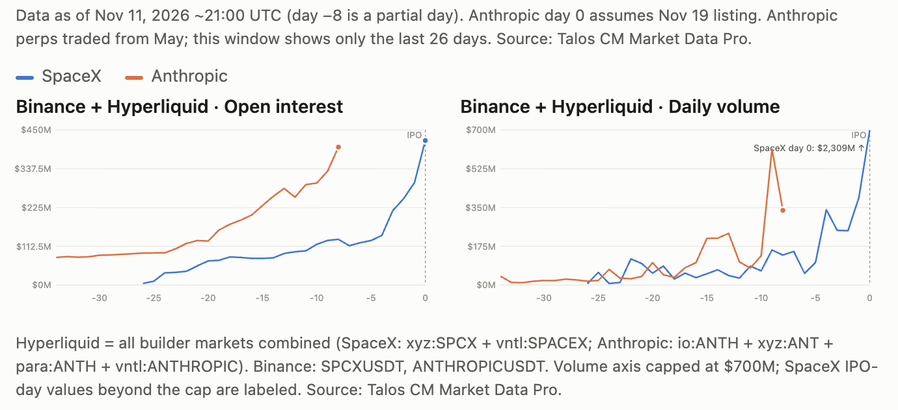

# Bloomberg Query re: Anthropic Pre-IPO Preps Markets

- **Journalist:** [Matt Haldane](https://www.bloomberg.com/authors/AXyLY3I-ufo/matt-haldane), Crypto Reporter, Bloomberg, Singapore
- **Talos spokesperson:** Kelly Ye, Head of Research, Talos
- **Call with Kelly Ye x Matt Haldane arranged:** Thursday 12 November, 10:00 SGT
- **Matt Haldane has received:** [Countdown to ANT: What the Pre-IPO Perps Markets Say About Anthropic’s IPO](https://www.talos.com/insights/countdown-to-ant-what-the-pre-ipo-perps-markets-say-about-anthropics-ipo)
- **Matt's question:** *"I mostly wanted to check on how the implied valuation was being calculated and how different perps were valuing Anthropic."*
- **Date:** 12 November 2026

---

## Pre-call data and observations, Talos:

1. **Raw prices from different venues aren’t directly comparable.** Venues quote in different units:

   - **TradeXYZ** (~$100): price of one Class A share
   - **OKX** (~$105–110): per-share price based on its own share count assumption, currently 13.1B
   - **Binance, Entropy, Bitget, Gate** (~$1,400): company market cap valuation in billions, so $1,400 ≈ $1.4T

2. **There are two kinds of price gaps.** Some come from quote conventions and are mechanical. The rest are real differences that remain after you put venues on a common valuation basis. After adjustment for quoting convention, we still see a wide range across venues, but the implied valuation averages about **$1.4T**, down from more than **$2T** at its peak. The range between venues reflects different investor expectations and real uncertainty about the deal.

3. **Share count is a moving target.** The issuer and its banks set the share count together with the IPO price, and it wasn’t published until Anthropic’s amended S-1 on Nov 10. Per-share venues have to assume a count and correct it later. **OKX launched with a 1B-share placeholder, moved to 10B in June, and on Nov 12 rebased to 13.1B based on the amended S-1. It settled open positions at the old price and reopened them at the new scale.** Venues also choose which shares to count (Class A only, outstanding, or fully diluted), so their per-share numbers still differ after the filing.

4. **Perps still give a useful early read.**

   - **How early:** Anthropic perps have traded since May, about 6 months before the IPO. SpaceX perps launched only 3–4 weeks before its listing.
   - **SpaceX track record:** perps traded about 15% above the $135 offer price days before the IPO, and around $176 on day one. That overshot the $150 open by about 17%, but they called the first-day pop, and within a week they traded within 2% of the stock.
   - **React to news and markets:** Anthropic’s implied valuation fell after the S-1 and its amendment. Pre-IPO ANT has a beta of 0.72 to the QQQ and 1.15 to the S&P 500.

5. **The pre-IPO financial market is growing fast.**

   - More than **$260M** of open interest across Entropy, TradeXYZ and OKX
   - TradeXYZ alone reached **$65M** of open interest in under four days
   - SpaceX perps did **$2.2B** in cumulative volume before the IPO
   - Exchanges are launching more ways to get pre-IPO exposure, including perps, tokenized IPO subscriptions and options, mostly for non-US users. None of these give holders actual shares.

### Quote from [Kelly Ye](https://www.linkedin.com/in/kelly-ye-cfa-60250b7/), Head of Research, Talos

> *"Pre-IPO perps aren’t a crystal ball. Venues quote in different units, share counts shift right up to the S-1, and even on a like-for-like basis traders could have a wide range of valuation opinions. But that’s the point. For the first time, there’s a live, tradable read on what the market thinks a private company is worth, months before the IPO order book opens."*

---

## Post-call data and observations, Talos:

### 1. ANT vs. SPCX pre-IPO trading volume comparison

Anthropic’s pre-IPO trading activity is far ahead of SpaceX’s. On the two major venues, Binance and Hyperliquid, Anthropic’s open interest eight days before its IPO was $400M, about 3x what SpaceX had at the same point ($133M). It’s already close to SpaceX’s IPO-day level ($419M).

*Figure note: Data as of Nov 11, 2026 ~21:00 UTC (day -8 is a partial day). Anthropic day 0 assumes Nov 19 listing. Anthropic perps traded from May; this window shows only the last 26 days. Source: Talos CM Market Data Pro.*

*Hyperliquid = all builder markets combined (SpaceX: xyz:SPCX + vntl:SPACEX; Anthropic: io:ANTH + xyz:ANT + para:ANTH + vntl:ANTHROPIC). Binance: SPCXUSDT, ANTHROPICUSDT. Volume axis capped at $700M; SpaceX IPO-day values beyond the cap are labeled. Source: Talos CM Market Data Pro.*

### 2. Normalized ANT price comparison

Across the four venues, the per-share price is about $101–105, which implies a circulating market cap of $1.32–1.38T and an FDV of $1.81–1.90T. That is roughly 29–35% above $78, the top of the $70–78 price range in Anthropic’s amended S-1 filed on Nov 10, 2026. At $78, Anthropic would be worth about $1.02T on a circulating basis and $1.40T fully diluted. The final IPO price hasn’t been set yet; pricing is expected around Nov 18, and it could land outside the range.

| Venue | Screen price | Per-share equivalent* | Quote convention | Source of convention | Implied circulating market cap (~13.09B shares) | Implied FDV (~18B shares) |
|---|---:|---:|---|---|---:|---:|
| **TradeXYZ** (xyz:ANT) | **$103.88** | **$103.88** | Price of **1 Class A share** | trade.xyz spec index | **$1.36T** | **$1.87T** |
| **OKX** (ANTHROPIC-USDT-SWAP) | **$138.16** | **~$105.34** after rebase (÷1.3116) | Per share on a **10B-share placeholder**. Rebases to 13.12B (not fully diluted) today at 09:00 UTC. | OKX rebase notice | **$1.38T** | **$1.90T** |
| **Entropy** (io:ANTH) | **$1,810.0** | **~$100.56** (÷18B) | **FDV in $B**; converts on a fully diluted count | Entropy trade page; Talos article | **$1.32T** | **$1.81T** |
| **Binance** (ANTHROPICUSDT) | **$1,381.38** | **~$105.53** (÷13.09B)† | Per share on a **1B-share placeholder**, so the price ≈ valuation in $B. Share basis and conversion rule not published. | Binance launch notice (via TechFlow) | **$1.38T** | **$1.90T** |

\* Per-share equivalent = the screen price converted to one Class A share using the venue’s share basis.

† Assumes Binance’s valuation is on a circulating (shares outstanding) basis. Binance doesn’t say so; I inferred it because its price lines up with TradeXYZ.

#### Notes

- **Data source:** Talos CM Market Data Pro, last trade price on the 1-minute candle at 03:01 UTC, Nov 12, 2026.
- **Share counts:** ~13.09B circulating (Class A + Class N after the IPO) and ~18B fully diluted (adds options and RSUs), both from Anthropic’s amended S-1 filed Nov 10, 2026.
- **Calculations:**
  - Circulating market cap = per-share equivalent × 13.09B
  - FDV = per-share equivalent × 18B

### Quote from [Kelly Ye](https://www.linkedin.com/in/kelly-ye-cfa-60250b7/), Head of Research, Talos

> *"Anthropic pre-IPO perps have grown about fivefold in a month to around $400 million in open interest, roughly 3x SpaceX at the same stage. Venues quote differently, but normalized to a per-share Class A price they agree at about $101–105, implying a circulating market cap of about $1.35 trillion. That’s roughly 30% above the top of the $70–78 IPO range."*
